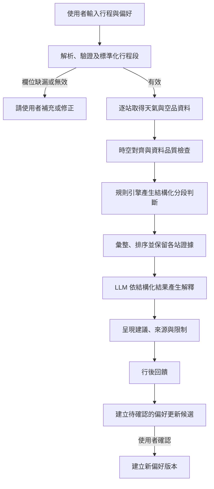
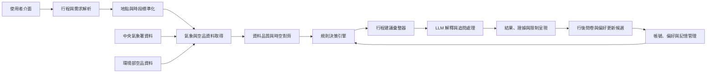

# 個人化天氣助理系統設計

> 本文件描述所提出的目標系統與設計方案，不代表所有模組均已實作。技術框架、部署方式、資料庫選型及各項規則的實際門檻，待實作與驗證階段決定。

## 1. 目的與範圍

個人化天氣助理整合中央氣象署（CWA）的天氣預報與環境部（MOENV）的空氣品質資料，針對使用者行程中的各停留地點與時段，提供考量活動情境及個人偏好的行前建議。

系統的目標是將官方環境資料轉化為可理解、可追溯的準備建議，而非重新預測天氣或取代官方資訊。每項建議應可回溯至資料來源、適用地點與時段、使用規則及相關偏好。

### 1.1 範圍內

- 建立多站行程；每一站包含地點、停留時間、活動型態及戶外暴露程度。
- 標準化臺灣地點、行政區、空品區與行程時段。
- 取得並對齊天氣預報、即時空品或官方空品預報。
- 依領域規則與使用者明確設定的偏好，產生分段及全行程建議。
- 透過大型語言模型（LLM）解析自然語言補充內容及解釋既有建議。
- 顯示資料來源、更新時間、有效時段與資料限制。
- 蒐集行後回饋，提出需由使用者確認的偏好更新候選。

### 1.2 範圍外

- 預測或修改官方天氣與空品資料。
- 推算未提供的資料，或以目前觀測值代替未來預報。
- 分析站點之間的實際移動路線；系統只分析使用者指定的停留站。
- 僅依個人主觀回饋推翻健康防護規則。
- 未經使用者確認，自動修改長期偏好。

## 2. 設計原則

1. **官方資料優先**：建議由有來源紀錄的官方資料及明確規則產生。
2. **逐站判斷、全程彙整**：每個行程段獨立取數與判斷，再依重要性彙整，並保留各站證據。
3. **健康防護與舒適偏好分離**：偏好可調整舒適提醒及呈現優先順序；不可移除重要健康防護提醒。
4. **不確定性明確呈現**：資料缺漏、過期、空間粒度不足或沒有適用預報時，說明限制並避免產生無依據判斷。
5. **LLM 不負責決策**：LLM 可解析及解釋，但不可新增數值、變更規則判定或補造資料。
6. **個人化可檢視、可控制**：偏好由使用者設定，候選更新須經使用者確認。
7. **結果可重現**：保存足以重現判斷的資料快照、規則識別碼及偏好版本。

## 3. 使用情境與主要流程

使用者可輸入如「上午在臺中市南區步行上課，下午到彰化市參加戶外活動」的多站行程，並設定或選用個人偏好。系統將每站標準化後，取得符合地點與時段的資料，檢查資料品質，再產生分段建議及全程摘要。



## 4. 系統架構



| 模組                   | 責任                                                       | 輸入                   | 輸出                                          |
| ---------------------- | ---------------------------------------------------------- | ---------------------- | --------------------------------------------- |
| 使用者介面             | 建立、編輯行程與偏好；顯示建議、證據及限制                 | 地點、時間、活動、偏好 | 行程請求、結果畫面                            |
| 行程與需求解析         | 將表單或自然語言補充轉成行程欄位；不確定欄位交由使用者確認 | 使用者輸入             | 行程段草稿                                    |
| 地點與時段標準化       | 驗證臺灣地點，解析座標、鄉鎮市區、空品區及時間範圍         | 行程段草稿             | `ItinerarySegment`                            |
| 帳號、偏好與記憶管理   | 管理明確偏好、歷史紀錄、回饋與待確認更新                   | 帳號資料、回饋         | `UserProfile`、歷史紀錄                       |
| 氣象與空品資料取得     | 呼叫官方來源並保留來源 metadata                            | 標準化行程段           | 原始資料及來源 metadata                       |
| 資料品質與時空對齊     | 檢查資料時間、空間粒度、測站距離、有效性及缺漏             | 原始資料、行程段       | `EnvironmentalSnapshot`、品質狀態             |
| 規則決策引擎           | 依領域規則、資料品質及偏好產生可追溯判斷                   | 環境快照、行程段、偏好 | `SegmentDecision`                             |
| 行程建議彙整器         | 排序跨站提醒、合併重複內容並保留分段依據                   | 多個 `SegmentDecision` | `TripRecommendation`                          |
| LLM 解釋與追問處理     | 將既有判斷轉成自然語言，回答判斷依據問題                   | 結構化判斷紀錄         | 解釋文字                                      |
| 結果呈現               | 分層顯示建議、原因、資料來源及限制                         | `TripRecommendation`   | 使用者可讀結果                                |
| 行後問卷與偏好更新候選 | 記錄實際遭遇與建議符合度，提出待確認候選                   | 問卷、歷史紀錄         | `FeedbackRecord`、`PreferenceUpdateCandidate` |

## 5. 資料來源與時空對齊

### 5.1 資料來源

| 資料     | 來源與資料內容                                                    | 對齊單位與使用時機                               | 必須保留或顯示                         |
| -------- | ----------------------------------------------------------------- | ------------------------------------------------ | -------------------------------------- |
| 天氣預報 | CWA 氣象開放資料：氣溫、相對濕度、降雨機率、紫外線及天氣描述      | 鄉鎮市區與預報時段；適用於可取得資料的未來行程段 | 鄉鎮、預報起訖、發布時間               |
| 即時空品 | MOENV AQI 與污染物監測資料：AQI、主要污染物、污染物數值及測站座標 | 當前或正在進行的行程段，採用最近可用測站         | 測站、距離、發布時間、主要污染物       |
| 空品預報 | MOENV `AQF_P_01`                                                  | 官方隔日預報可用時，依空品區與預報日期使用       | 空品區、預報日期、發布時間、主要污染物 |

空品預報是空品區與日期層級資料，不可呈現為特定地點、特定小時的觀測值。即時測站資料與空品預報須標示為不同資料類型。

### 5.2 空品資料選擇

1. 行程段正在進行或屬於當前時段：使用最近可用的 MOENV 測站即時資料。
2. 行程段符合官方隔日空品預報範圍：使用該空品區的官方預報。
3. 行程段超出官方空品預報範圍：仍可產生可用的天氣建議；空品標示「尚無官方預報」，不產生空品風險判定。
4. 地點、資料有效時間或發布時間無法合理對齊：標記限制，不補值、不推測。

### 5.3 品質檢查

每筆資料需區分觀測值與預報值，並保留來源、發布時間、取得時間、有效時段及空間參照。品質旗標至少涵蓋：

- `missing`：必要欄位或來源資料缺漏。
- `stale`：資料超出可接受的新鮮度或有效時間。
- `spatially-coarse`：資料空間解析度不足以支持精確到該地點或時段的結論。
- `unavailable`：該來源或預報範圍沒有可用資料。

品質檢查結果應傳遞至決策與呈現層。受影響的建議應限制或停止判斷，並向使用者說明原因；不得以 LLM 生成文字填補資料空缺。

## 6. 核心資料模型

以下為概念模型；欄位型別、資料庫結構及保存期限需於實作階段確定。

```text
UserProfile
- userId
- explicitPreferences: rainTolerance, sunProtectionPriority,
  airQualityAlertSensitivity, thermalPreference
- confirmedPreferenceVersion
- createdAt, updatedAt

ItinerarySegment
- segmentId, itineraryId
- placeName, latitude, longitude
- township, airQualityArea
- startTime, endTime
- activityType, outdoorExposureLevel

EnvironmentalSnapshot
- segmentId, sourceType, sourceName
- spatialReference: township | station | air-quality-area
- observedOrForecastTime, publishedAt, fetchedAt
- weather: temperature, humidity, precipitationProbability, uvIndex
- airQuality: aqi, majorPollutant, pollutantValues
- qualityFlags: missing | stale | spatially-coarse | unavailable

SegmentDecision
- segmentId
- alerts: category, priority, recommendedAction
- evidence: source fields, ruleId, profile factors
- limitations

FeedbackRecord
- itineraryId, segmentId, submittedAt
- perceivedWeatherMatch, perceivedAirQualityMatch
- recommendationUsefulness, freeText

PreferenceUpdateCandidate
- preferenceKey, proposedValue, reason, evidenceSummary
- status: pending-confirmation | accepted | rejected
```

決策紀錄應關聯使用的行程段、環境快照、規則識別碼與偏好版本，以支援追溯與重現。明確偏好、行程紀錄與行後回饋應分開管理；使用者可檢視、修改及刪除明確偏好。

## 7. 決策規則與 LLM 邊界

### 7.1 規則引擎

規則引擎負責數值比較、防護條件與優先順序。每條規則需有版本識別，並為輸出附上 `ruleId` 及實際輸入證據。第一版涵蓋：

1. **降雨準備**：考量降雨預報、預報時段、戶外暴露及使用者雨具接受度。
2. **紫外線防護**：考量 UV 資訊、戶外暴露程度及防曬偏好。
3. **空品防護**：考量 AQI、主要污染物、資料類型及空品提醒偏好；不可只依 AQI 推定相同防護內容。
4. **冷熱舒適**：考量溫度、濕度、活動與個人偏冷／偏熱傾向。
5. **資料品質**：資料缺漏、過期、空間粒度不足或時段不符時，降低或停止相應判定。

具體門檻與適用指引應依適用的官方健康／防護指引設定，並在實作與評估中驗證；本文件不預設未經 README 定義的數值門檻。重要防護提醒優先於舒適提醒。個人偏好不得刪除重要防護提醒。

### 7.2 LLM 可執行工作

- 將自然語言補充解析為結構化欄位；存在歧義時要求使用者確認。
- 依 `TripRecommendation` 撰寫易讀摘要。
- 根據既有 `SegmentDecision.evidence` 與 `limitations` 回答「為什麼這樣建議？」。

### 7.3 LLM 禁止事項

- 編造或自行補入未記錄的天氣、空品數值與來源。
- 修改規則引擎判定、警示優先級或健康防護結論。
- 將即時觀測寫成未來預報，或將空品區預報描述成單一地點的即時值。
- 對資料不足的時段推測環境狀況。

生成文字需檢查是否忠實保留數值、重要提醒、適用時段與資料限制。若解釋生成失敗，仍應保留並呈現結構化決策及來源證據，不應以另一個未驗證的生成結果取代。

## 8. 端到端處理邏輯

```text
輸入：使用者 U、行程 I、明確偏好 P
輸出：全行程建議 TR

1. 驗證行程段的臺灣地點、時間與活動欄位；無效時請使用者修正。
2. 將每段行程標準化為地點、鄉鎮、空品區及時間範圍。
3. 對每個行程段：
   a. 依鄉鎮與時間取得 CWA 天氣預報。
   b. 依行程時段選擇 MOENV 即時測站資料、隔日空品預報或不可用狀態。
   c. 對齊資料並檢查發布時間、有效時段、空間參照及品質旗標。
   d. 對關鍵資料不足的面向產生有限判斷，並記錄限制。
   e. 對可判斷的面向執行降雨、UV、空品與冷熱舒適規則。
   f. 記錄警示、來源證據、ruleId、偏好因素及限制。
4. 彙整各段判斷，合併重複提醒；保留各提醒所屬的地點、時段與依據。
5. 排序時優先呈現重要防護，再呈現舒適提醒。
6. 保存決策紀錄，再由 LLM 依結構化紀錄生成文字解釋。
7. 回傳行程摘要、分段結果、資料來源及限制。
```

## 9. 偏好、回饋與記憶

系統應分別管理：

1. **明確偏好**：由使用者設定，可檢視、修改及刪除，並以版本識別。
2. **行程及決策紀錄**：保存行程、當時使用的資料快照與建議，供追溯與評估。
3. **行後回饋**：記錄實際天氣／空品符合度、建議有用性及選填文字。
4. **偏好更新候選**：由多筆回饋形成待確認建議，不直接改寫使用者檔案。

只有使用者接受候選更新後，系統才建立新的偏好版本。回饋可用於調整舒適提醒或資訊排序，但不能單獨證明健康風險不存在，也不能推翻官方防護依據。

## 10. 例外與限制處理

| 情況                               | 系統處理                                                             |
| ---------------------------------- | -------------------------------------------------------------------- |
| 行程地點、時間或活動無效／缺漏     | 暫停相關處理，要求使用者補充或修正，不以猜測值繼續。                 |
| 官方來源請求失敗或無資料           | 標示受影響的資料面向不可用；其他資料足夠時，仍可提供未受影響的建議。 |
| 資料過期或有效時段不符             | 標示過期／時段限制，不將其當作目前或目標時段的確定狀況。             |
| 空間粒度不足或測站距離較遠         | 揭露資料的代表範圍與測站距離，限制對精確地點的結論。                 |
| 超出官方空品預報範圍               | 顯示尚無官方空品預報，不產生空品風險判定；可繼續提供天氣建議。       |
| LLM 解析不確定                     | 將解析結果交由使用者確認；不得把不確定內容當成已確認行程欄位。       |
| LLM 解釋失敗或內容不符合結構化判斷 | 不採用不一致的文字；呈現結構化建議、證據與限制。                     |

## 11. 評估與驗證

### 11.1 比較組

- **Baseline A**：僅呈現官方天氣與 AQI 原始數值。
- **Baseline B**：固定規則搭配固定文字模板。
- **Proposed**：規則引擎、個人偏好與 LLM 說明。

各比較組應使用相同資料、行程、偏好輸入及評分標準；生成式方法應進行多次測試，觀察輸出變異。

### 11.2 測試情境

- 多站、跨鄉鎮及不同停留時段的行程。
- 有降雨機率且使用者不願攜帶雨具。
- 高 UV 且長時間戶外活動。
- AQI 相同但主要污染物不同。
- 當前行程的測站即時資料與隔日空品預報切換。
- 資料過期、缺漏、空間粒度不足或超出空品預報範圍。

### 11.3 評估指標

| 類別     | 指標                                           |
| -------- | ---------------------------------------------- |
| 正確性   | 建議是否可由保存的官方資料與規則重現。         |
| 完整性   | 重要提醒遺漏率、資料限制揭露率。               |
| 個人化   | 使用者對行後符合度與建議有用性的評分。         |
| 可理解性 | 使用者能否辨識建議所屬站點、時段與原因。       |
| 系統性   | API 請求成功率、資料過期處理率與系統回應時間。 |

評估時應分開檢視主觀滿意度與可靠性。若個人化提升滿意度但增加重要提醒遺漏，不應僅以滿意度判定方案較佳。

## 12. 尚待實作階段決定

- 網站前端、後端、資料庫與部署平台的技術選型。
- 官方 API 的具體端點、金鑰管理、請求頻率及重試策略。
- 地點解析、測站最近距離的計算方式與可接受空間誤差。
- 各資料來源的新鮮度門檻及資料品質降級策略。
- 各項規則的實際門檻、版本管理流程與官方指引對照。
- 帳號驗證、資料保存期限及完整的個人資料管理政策。
- LLM 供應者、提示設計、逾時策略與生成內容驗證方式。
